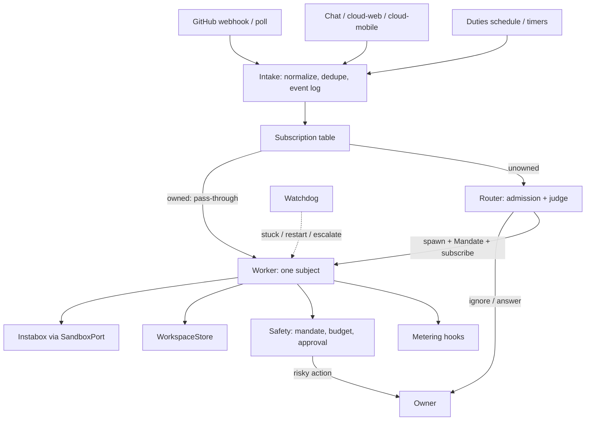
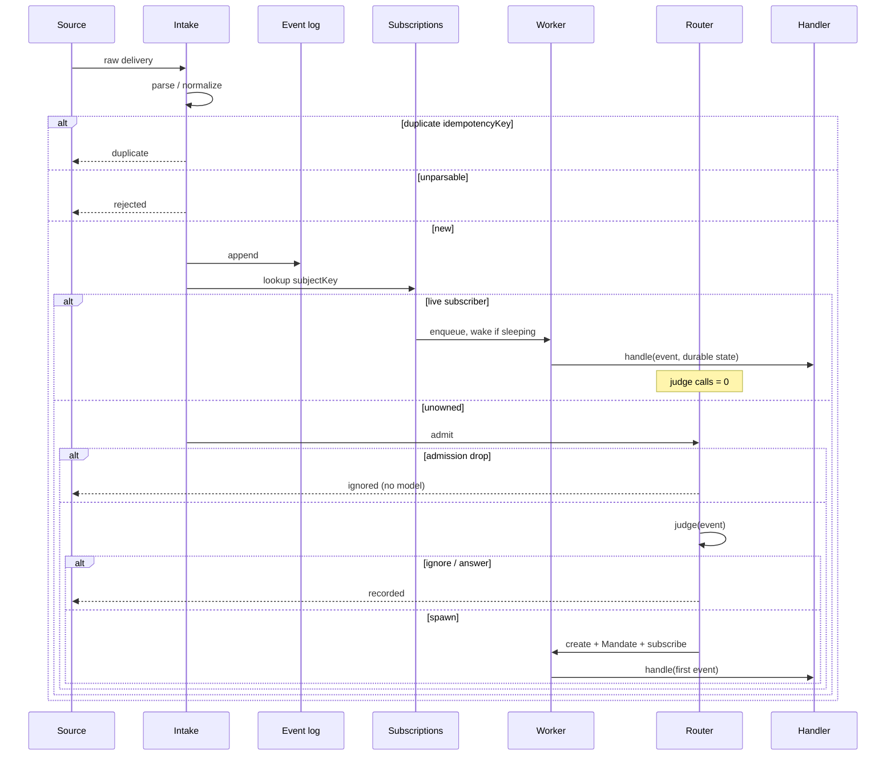
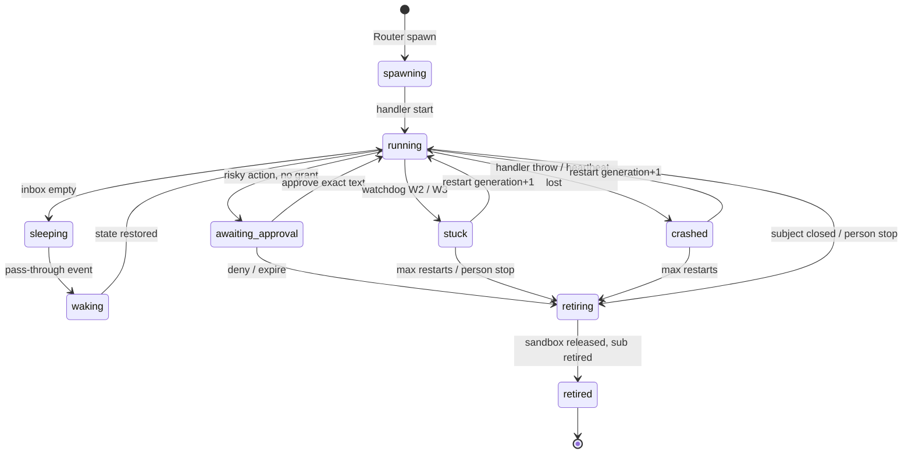

# Super-agent architecture (maka-cloud)

Status: the agreed product direction for turning maka-cloud into a
DeepSeek-Harness-style Super-agent, as a paid hosted product. This document is
the detailed architecture. The core that implements it lives in
`packages/cloud-superagent` (`@maka-cloud/superagent`).

It refines the signed-off design page ("hi × maka-cloud: 用 Super-agent 与
LayerFS 搭一套系统", 2026-11-01) against the code on `main` and the open pull
requests. Where the page and the code disagree, the code wins and this document
says so.

Sources of the pattern (ideas, not code unless noted):

- DeepSeek Harness article *Exploring Super-agent Design* (2026-11-01). The
  article's ablation is 31.8M → 23.2M Router cache-read tokens with
  pass-through, about **27% fewer** Router tokens (the page's earlier "37%"
  figure was the inverse).
- [dsh-superagent-prototype](https://github.com/deepseek-ai/dsh-superagent-prototype)
  (MIT). Domain terms (Trigger, Thread, Eval, Mandate, Ticket, Subscription)
  may be borrowed with attribution. The prototype runs as the operator's OS
  user with `danger-full-access` and no isolation; we do not.
- [LayerFS](https://github.com/Ephemeral-AI-Lab/layerfs) (MIT). Workspace
  store only, behind a feature flag, off by default, gated on a spike.
- [MAGI](https://github.com/realTaki/MAGI) (BUSL-1.1). Ideas only: fail-wake
  cap of three, background work default-zero-spend, store/test/activate/publish
  as four distinct actions. No MAGI code.

hi (the phone agent) is out of this repository. Option A from the design page
stands: hi stays an independent on-device agent. A later, default-off, read-only
"cloud hands work to a development phone" channel is not designed here.

## 1. Why this, and what it is not

A single conductor conversation that starts a new orchestrator task on every
GitHub event does not scale. The owner cannot follow more than a handful of
sessions, every follow-up spends Router tokens, and a task that opened a pull
request forgets the pull request the moment the conversation ends.

A Super-agent is one continuous employee:

- **Continuous.** The owner talks to one agent in chat and on GitHub. Sessions
  are an implementation detail.
- **Productive.** Many workers run at once. Each owns one subject.
- **Proactive.** Events drive work. The agent is quiet when nothing is worth
  doing.
- **Persistent.** Workers sleep between events, resume from durable state, and
  survive a host restart.

It is not a rewrite of Maka, not a DeepSeek Harness plugin, and not a boat.dev
product. Compute stays in `@maka-cloud/host`. Execution stays in Instabox
behind a `SandboxPort` that matches the `SandboxApi` seam of open PR #452.
Durable task logs stay in `@maka-cloud/orchestrator`. The Super-agent package
is the **event, subscription, worker-lifecycle, watchdog and safety** layer
that those packages do not have.

### 1.1 Non-goals

- Pricing, invoices, or a payment provider (metering hooks only).
- Running LayerFS, FUSE, or Docker in this slice.
- Merging or depending on the parked boat.dev PRs (#451, #453, #455).
- Commenting on, closing, or landing the open PRs this document maps to.
- hi Relay, remote unlock, or any path that lets the cloud approve a payment
  on a phone.
- A third coding vendor, Claude subscription login, or branding as
  "Claude Code".
- Silent speculative "reproduce and fix" before the first live run.
- Email, Slack, or Feishu channels.

## 2. How this maps to the code that already exists

maka-cloud already has most Super-agent parts under other names. The gap is
**subscription pass-through** and **one worker that owns a subject for its
life**.

| Super-agent part | Existing code | Gap this architecture fills |
|---|---|---|
| Router (no Bash) | `@maka-cloud/conductor`: tools are `start_playbook`, `delegate_task`, `task_status`, `task_wait`, `task_cancel`, `ask_user`, `notify`. Confirmed: no Bash. | Conductor is per-conversation, not a long-lived Router. Super-agent adds a deterministic admission + optional judge in front of it, and only calls a model for **unowned** events. |
| Workers | `@maka-cloud/runners` `SandboxCliRunner` + orchestrator tasks (T28) | A task dies with its conversation. Super-agent workers outlive a turn, sleep, and resume. |
| Triggers | `@maka-cloud/duties` webhooks + five trigger kinds; cards (T30, off at launch) | Duties start a **new** conductor run per event. Super-agent normalizes events, then routes. Duties become one Source, not the router. |
| PR follow-up | Open PR #460 (`FollowUpPorts`, `pr-follow-ups.json`, one bounded CI fix) | The first WorkItem kind. Super-agent generalizes the subject to issue and chat thread. Do not duplicate #460; wrap it. |
| Durable state | T28 step log, epoch fence, transcript mirror | Worker record adds memory, plan, transcript pointer, mandate, inbox offset. The step log remains the record of a **run**; the worker record is the record of a **subject**. |
| Watchdog | `@maka-cloud/supervisor` R1–R5 ("rules decide, models describe"); T33 stuck report is docs only (#444) | Super-agent watchdog is a second, subject-level loop: stuck, looping, over-budget, crashed. It calls supervisor-shaped escalation; it does not replace R1–R5. |
| Sandbox | `@maka-cloud/instabox` `InstaboxClient`; open PR #452 `SandboxApi` | Super-agent talks to `SandboxPort` (the #452 pick). Default adapter is Instabox. boat.dev stays parked. |
| Workspace | Fresh git clone per task in the box | `WorkspaceStore` with `GitCloneStore` default. LayerFS behind a flag. |
| Approvals | Conductor `GrantRow` bound to exact text; T15 taint; duty `Authority` | Worker `Mandate` + Super-agent approval kinds (merge, protected push, secrets, deploy, spend). Conductor grants stay for conductor tools. |
| Isolation | `docs/fork/isolation-model.md` I1–…; one box per invite at launch | Tenant id on every Super-agent row. A worker never sees another tenant's store, sandbox, or secrets. |
| Spend | Gateway caps, duty `runBudgetUsd` / `dailyCapUsd`, orchestrator `budgetUsd` | Per-worker budgets on the Mandate; metering hooks for a later ledger (T17). |

### 2.1 Open pull requests

| PR | Role | What we do |
|---|---|---|
| #444 T33 stuck-report (docs) | Typed `ask_user` reason `stuck`; ≤2 unverified delegations; integrity scan | Watchdog findings use that shape when they escalate. Do not re-specify T33. |
| #452 `SandboxApi` | `Pick<InstaboxClient, ensureRunning \| exec \| getMachine \| snapshots \| leases>` | Super-agent's `SandboxPort` is that pick. When #452 merges, `InstaboxClient` satisfies it with no adapter. |
| #451 / #453 / #455 boat.dev | Parked | Do not import. Instabox remains the execution environment. |
| #460 PR follow-up | One worker per coding-task PR until checks speak | First subject kind. `FollowUpBridge` maps a #460 watch onto a Super-agent subject. Auto-fix stays off (`MAKA_CLOUD_PR_AUTOFIX` default). |
| #449 upstream sync | Daily merge-commit sync | Super-agent is a new `packages/cloud-*` package so the next sync does not touch it. |
| #458 viewport proof | Evidence for result cards | Out of Super-agent scope; workers may later point at a preview. |

### 2.2 Where the new code lives

```
packages/cloud-superagent/     @maka-cloud/superagent
  events, intake, router, workers, watchdog, safety,
  WorkspaceStore, SandboxPort, SuperagentStore (memory + sqlite)

docs/fork/architecture/superagent.md   this file
```

The package depends on `zod` only. It does **not** import `@maka-cloud/host`,
`server`, `conductor`, `duties`, or `runners`. Those compose it later through
ports. That keeps the next apache/maka merge cheap and lets host tests stay
unchanged until a dedicated wiring PR.

`WorkspaceStore` was proposed for `cloud-runners` in
`docs/fork/design/layerfs.md`. It starts here so P1 does not edit runners. P3
may re-export it from runners when the coding playbook starts calling
`prepare()`.

Persistence is a **package-local SQLite file** (`superagent.sqlite`), exclusive
lock, same pattern as duties and supervisor. It is **not** a `cloud-server`
schema migration. A later host PR may move the file next to the server data
dir; that still needs no server-table migration.

## 3. Components



| Component | Responsibility | Must not |
|---|---|---|
| **Intake** | Turn a raw GitHub / chat / timer payload into a `NormalizedEvent`. Idempotent on `(tenantId, idempotencyKey)`. Append to the event log. Classify the `Subject`. | Call a model. Guess a malformed payload. |
| **Subscription table** | Map `subjectKey → workerId` for live workers. Fan-out is code. | Invent work. Change a Mandate. |
| **Router** | Fast path: deterministic admission (source, actor, allow-list, tenant pause). Slow path: `RouterJudge` (heuristic in tests; model later) decides `ignore`, `answer`, or `spawn`. | Execute, hold Bash, or see a subscribed follow-up. |
| **Worker** | Own exactly one subject. Durable memory / plan / transcript pointer / inbox. Sleep, wake, retire. Call `WorkerHandler` (wired to a runner in a later PR). | Talk to the owner except through Router or an approval. Cross a tenant. |
| **Watchdog** | External tick. Detect stuck, loop, over-budget, crash. Restart (capped) or escalate. | Run inside the worker handler. Use a model to decide a restart. |
| **Safety** | Mandate, budgets, approval bound to exact text, audit log, tenant scoping. | Trust a model "I am allowed". |
| **WorkspaceStore** | Prepare a workspace. Default: git clone. LayerFS: flag + spike. | Be the only copy of a kept change. |
| **SandboxPort** | Exec / ensureRunning / machine / snapshot on Instabox. | Hold `INSTABOX_API_KEY` in a worker or a box. |
| **Metering** | `record(usage)` hook. | Price anything. |

### 3.1 Two-level sessions, as they land here

The article's Router is one long-lived LLM session. maka-cloud already has a
conductor that must stay append-only (Opus 5.5 preserved thinking). We do
**not** replace that session with a second model loop in P1.

P1 Router is code: admission + `RouterJudge`. The default judge is a
heuristic. A later PR may put unowned events through the existing conductor
as a **new conversation that is only allowed the Router tool set** (still no
Bash, still no `delegate_task` that execs). That conversation is not the
owner's chat.

Workers are not conductor conversations. A worker's execution is an
orchestrator task (T28) started by a host adapter. The worker record points
at that task's transcript. When the task finishes, the worker **sleeps**; it
does not retire unless the subject closes.

## 4. Data model

Every row is scoped by `tenantId` (today: the invite id; later: the org id).
A query that omits `tenantId` is a bug.

### 4.1 Subject and Thread

A **Subject** is the thing a worker owns. A **Thread** is the event stream of
that subject. For P1 they are 1:1 (`subjectKey` is the thread key). The
subscription table is many-to-many so a later reviewer worker can subscribe
to the same PR without a migration.

```
subjectKey =
  pr:<tenant>:<repo>#<n>
  | issue:<tenant>:<repo>#<n>
  | chat:<tenant>:<conversationId>
  | check:<tenant>:<repo>:<sha>:<name>     /* correlation only; not owned */
```

| Field | Type | Notes |
|---|---|---|
| `kind` | `pull_request` \| `issue` \| `conversation` | Owned kinds. |
| `tenantId` | string | Required. |
| `repo` | `owner/name` | GitHub subjects. |
| `number` | int | PR or issue number. |
| `conversationId` | string | Chat subjects. |
| `closed` | bool | Set by a close/merge event. |

DSH allows several Tickets per Thread. The product decision here is
**one live owner per subject**. A second spawn on the same `subjectKey` is
refused (`already_owned`). The Router may later grow an `attach` decision
for a reviewer; the table already allows it, the policy does not.

### 4.2 NormalizedEvent (Trigger)

Immutable once stored.

| Field | Type | Notes |
|---|---|---|
| `eventId` | `evt_…` | Assigned at ingest. |
| `tenantId` | string | |
| `source` | `github` \| `chat` \| `timer` \| `internal` | |
| `type` | string | `pr_opened`, `pr_closed`, `issue_opened`, `issue_comment`, `review_comment`, `ci_failed`, `ci_passed`, `user_message`, `tick`, `subject_closed`, … |
| `subject` | Subject | May be absent only for `ping`. |
| `idempotencyKey` | string | GitHub delivery id; chat message id; timer slot id. |
| `actor` | `{ login, kind: user\|bot\|system }` | |
| `occurredAt` | ms | From the source when present. |
| `receivedAt` | ms | Host clock. |
| `summary` | string | **Code-built**. Numbers and fixed words only. |
| `fields` | `[label, value][]` | Other people's text. Quoted when a model sees it. |
| `closesSubject` | bool | PR merged/closed, issue closed. |

Intake drops a payload it cannot parse. It does not invent a subject.

### 4.3 Subscription

| Field | Type | Notes |
|---|---|---|
| `subscriptionId` | `sub_…` | |
| `tenantId` | string | |
| `subjectKey` | string | |
| `workerId` | string | |
| `createdAt` | ms | |
| `retiredAt` | ms \| null | Soft; unique live index on `(tenantId, subjectKey, workerId)`. |

### 4.4 Worker record (Ticket)

| Field | Type | Notes |
|---|---|---|
| `workerId` | `wrk_…` | |
| `tenantId` | string | |
| `subject` | Subject | Frozen at spawn. |
| `state` | see §6 | |
| `generation` | int | Increments on restart. Watchdog cap is 3. |
| `mandate` | Mandate | Frozen at spawn. A wider scope is a new worker. |
| `memory` | string | Durable notes the handler wrote. |
| `plan` | string | Current plan text. |
| `transcriptPointer` | string \| null | Orchestrator task id or transcript path. |
| `sandboxRef` | string \| null | Instabox machine id. |
| `workspaceRef` | string \| null | `WorkspaceHandle.id`. |
| `lastEventId` | string \| null | Last consumed event. |
| `lastProgressAt` | ms | Watchdog W2. |
| `lastHeartbeatAt` | ms | Watchdog W1. |
| `lastStepSignature` | string \| null | Watchdog W3. |
| `stepRepeats` | int | |
| `usage` | `{ tokens, usdMicros, wallMs }` | |
| `createdAt` / `updatedAt` / `retiredAt` | ms | |

Inbox is a separate table: `(workerId, seq, eventId, deliveredAt, consumedAt)`.

### 4.5 Mandate

Frozen at spawn. Default intensity is **`observe`**.

| Field | Type | Notes |
|---|---|---|
| `policyVersion` | string | e.g. `maka-superagent.1`. |
| `scope` | `{ repos: string[]; paths?: string[] }` | |
| `intensity` | `observe` \| `act` \| `autofix` | `autofix` is never the default. Maps to `MAKA_CLOUD_PR_AUTOFIX` for PR subjects. |
| `authority` | `read-only` \| `open-pr` \| `merge-when-green` | Same ladder as duties / conductor. A worker cannot raise it. |
| `budgets` | `{ tokens?, usd?, wallMs? }` | Hard. Exceeding → W4, worker stops. |
| `strength` | `explicit` \| `inferred` | From the article / DSH. Inferred work stays `observe` unless a person raises it. |

### 4.6 Approval and audit

| Field | Type | Notes |
|---|---|---|
| `approvalId` | `apr_…` | |
| `kind` | `merge` \| `push_protected` \| `secrets` \| `deploy` \| `spend` \| `other_irreversible` | |
| `boundText` | string | Exact text the owner saw. Approve must match. |
| `state` | `pending` \| `approved` \| `denied` \| `expired` | |
| `expiresAt` | ms | Default 24h. |

Audit rows are append-only: ingest, route, spawn, sleep, wake, approve, deny,
watchdog finding, retire, usage. They are the product's proof that a paid
tenant can ask "what did it do, and who allowed it".

### 4.7 SQLite schema (package-local, version 1)

Not a `cloud-server` migration. New file. Additive later versions of this
file are allowed in follow-up PRs and must be called out.

```
events(event_id, tenant_id, idempotency_key, subject_key, source, type,
       occurred_at, received_at, json)
UNIQUE (tenant_id, idempotency_key)

subscriptions(subscription_id, tenant_id, subject_key, worker_id,
              created_at, retired_at)
UNIQUE live (tenant_id, subject_key, worker_id) WHERE retired_at IS NULL

workers(worker_id, tenant_id, subject_key, state, generation, json,
        created_at, updated_at, retired_at)

inbox(worker_id, seq, event_id, delivered_at, consumed_at)
PK (worker_id, seq)

approvals(approval_id, tenant_id, worker_id, kind, bound_text, state,
          created_at, decided_at, json)

audit(audit_id, tenant_id, worker_id, kind, at, json)

usage(tenant_id, worker_id, tokens, usd_micros, wall_ms, updated_at)
PK (tenant_id, worker_id)
```

`PRAGMA locking_mode=EXCLUSIVE` at open. A second process fails immediately
(`SuperagentDatabaseInUseError`). Unknown `user_version` is refused, not
guessed.

## 5. Event flow

### 5.1 Ingest and route



The point of the subscription table is the article's result: follow-ups on an
owned subject **do not enter the Router**. Tests assert `judgeCalls === 0` on
that path.

### 5.2 GitHub

Intake accepts a wider set than duties (`ACCEPTED_EVENTS`), because a worker
must see close/merge and PR open:

| GitHub event | Normalized type | Subject |
|---|---|---|
| `ping` | `ping` | none |
| `pull_request` opened / reopened | `pr_opened` | `pr:…#n` |
| `pull_request` closed / merged | `pr_closed` (`closesSubject`) | `pr:…#n` |
| `pull_request` synchronize | `pr_updated` | `pr:…#n` |
| `issues` opened | `issue_opened` | `issue:…#n` |
| `issues` closed | `issue_closed` (`closesSubject`) | `issue:…#n` |
| `issue_comment` | `issue_comment` | PR or issue, from payload |
| `pull_request_review` / `_comment` | `review_comment` | `pr:…#n` |
| `workflow_run` completed failure | `ci_failed` | PR if `head_branch` maps; else unowned |
| `workflow_run` completed success | `ci_passed` | same |

Duties still verify the HMAC (`readDelivery`). Super-agent Intake assumes a
delivery that already passed that gate, **or** is a test fixture. Host wiring
must not call Intake with an unverified body.

Self and bot actors never spawn (same rule as duties `isSelfOrBot`). They
**do** pass through to an existing worker, except the worker's own comments,
which Intake marks `actor.kind = bot` and the handler may ignore. This is how
#460 avoids a CI-fix loop.

### 5.3 Chat and timers

A user message in an existing conversation whose worker is live is
pass-through (steer). A message in a conversation with no worker goes to the
Router. A timer with no subscriber is ignored unless a duty Source marked it
as needing a judge (P1: timers without a subscriber are `ignore`).

### 5.4 Correlation

A `workflow_run` may not name a pull request number. Intake puts the event on
`check:<tenant>:<repo>:<sha>:<workflow>` and lists **correlated**
`subjectKey`s when the branch is `maka/…` or matches an open worker's repo +
branch. Correlation **never routes on its own**. Routing uses the owned
subject when one correlates; otherwise the event is unowned and usually
ignored (unowned CI is noise).

## 6. Worker lifecycle



Rules:

1. A worker owns **one** subject for its life. It does not steal another
   worker's subject.
2. Sleep writes durable state first, then may ask `SandboxPort` to suspend.
   Instabox already auto-suspends (300–1800 s). Sleep is a worker state, not
   a box state.
3. Wake restores memory, plan, transcript pointer, then consumes the inbox
   in `seq` order.
4. A host restart calls `restore()`: `running` / `waking` / `awaiting_approval`
   stay; `spawning` retries start; `crashed` waits for the watchdog;
   `sleeping` stays asleep.
5. Subject close → `retiring`. The handler gets one `subject_closed` event to
   write a last note. It cannot open a new PR on the way out.
6. A person stop withdraws the Mandate. Resume after stop requires a new
   Router spawn (new Mandate). DSH lets a human message reopen an ended
   Ticket under the same Mandate; we do **not**, because a paid product must
   not silently regain `act` after the owner stopped it.
7. Intensity `observe` may read and comment; it may not push, merge, or spend.

### 6.1 Assignment (execution)

DSH separates Ticket (domain) from Assignment (executor instance). We keep
that split without the name:

- The **worker record** is the Ticket.
- An **execution** is an orchestrator task + optional sandbox lease. The
  worker stores `transcriptPointer` and `sandboxRef`.
- A restart ends the execution (new generation) and keeps the worker.

P1's `WorkerHandler` is a port. The default test handler records events. The
host adapter (later PR) starts `delegate_task` / `SandboxCliRunner` and writes
the transcript pointer back.

### 6.2 Relationship to #460

```
coding playbook opens PR
        │
        ▼
#460 FollowUpStore watch (pr-follow-ups.json)
        │
        ▼
FollowUpBridge.subjectOf(watch) → pr:<tenant>:<repo>#n
        │
        ▼
Super-agent worker (if not already owned)
        │
        ├─ CI event → pass-through (no Router)
        ├─ review comment → pass-through
        └─ intensity=act + MAKA_CLOUD_PR_AUTOFIX → one bounded fix
           (still the #460 cap; Super-agent does not add a second fixer)
```

Until #460 merges, Super-agent still owns a PR subject created by the
Router (for example an issue that became a PR). The bridge is additive.

## 7. Router

### 7.1 Fast path (admission)

Deterministic, no model. Drops:

- `ping`
- source not in the tenant's allow-list
- actor in `selfLogins` or `bot` **when the event is unowned**
- tenant paused / over its daily cap (metering hook returns `stop`)
- subject already closed and unowned
- unowned `ci_*` (noise; owned CI pass-through already happened)
- inferred strength when the Policy says "explicit only"

Everything dropped is still in the event log (`disposition: filtered`).

### 7.2 Slow path (`RouterJudge`)

```ts
type RouterDecision =
  | { action: 'ignore'; reason: string }
  | { action: 'answer'; text: string }
  | { action: 'spawn'; mandate: Mandate; title: string };
```

P1 ships `HeuristicJudge`:

- Chat that asks for status and names no new work → `answer`.
- `issue_opened` / `pr_opened` from an allowed actor → `spawn` at
  `observe` unless the text contains an explicit work request the tenant
  marked as `act` (P1: spawn at `observe`).
- Everything else → `ignore`.

`ModelJudge` takes an injectable `JudgeClient`. `FetchJudgeClient` speaks
the same Anthropic Messages API as the host gateway (`/v1/messages`,
`x-api-key`, `anthropic-version`). HeuristicJudge stays the default;
`MAKA_CLOUD_SUPERAGENT_JUDGE=model` opts in. A missing client throws. A
bad or failed completion falls back to the heuristic. The conductor is a
candidate, but only with the Router tool set (no `delegate_task` that
starts a sandbox from the Router turn).

### 7.3 Batching

The article batches Triggers that arrive during one Router turn. P1
processes unowned events one by one. The store can list `pending_eval` on a
thread; P2 may batch them. Pass-through already removes the burst that made
batching necessary in the article.

## 8. Watchdog

External. Driven by `Superagent.tick(at)`. No model decides a restart.
Supervisor principle: **rules decide, models describe**.

| Id | Finding | Condition | Action |
|---|---|---|---|
| W1 | `crashed` | `state=running` and `now - lastHeartbeatAt > heartbeatAfterMs`, or handler threw | Restart if `generation < maxRestarts` (3), else escalate |
| W2 | `stuck` | `running`/`waking` and `now - lastProgressAt > stallAfterMs` | Escalate (T33 `stuck` shape). Do not grind. |
| W3 | `looping` | `lastStepSignature` repeated `loopRepeat` (3) times without progress | Escalate; optional restart once |
| W4 | `over_budget` | usage ≥ any Mandate budget | Stop handler, escalate, no restart |
| W5 | `subject_closed` | close event not yet retiring | Force `retiring` |
| W6 | `awaiting_expired` | pending approval past `expiresAt` | Deny, retire if the action was required |

Defaults: `stallAfterMs = 15m`, `heartbeatAfterMs = 2m`, `loopRepeat = 3`,
`maxRestarts = 3` (MAGI idea: wake at most three times, then a person).

Escalation is a structured finding the host turns into a supervisor inbox
item / `ask_user` `stuck` (T33). Super-agent does not send chat itself.

The watchdog **never** runs in the same call stack as `WorkerHandler.handle`
except for the usage check the handler already does. `tick()` is the host
cron.

## 9. Safety, approval, tenancy

This is the paid-product difference. The DSH prototype says its wrappers are
not a security boundary.

### 9.1 Layers (do not collapse)

| Layer | Who enforces | What it stops |
|---|---|---|
| Tenant row | Super-agent store | Cross-tenant read/write |
| Mandate | Safety, at spawn and before each action | Wider scope, raised authority, `autofix` by default |
| Conductor grant / T15 taint | `@maka-cloud/conductor` | Outside text driving a write |
| Duty authority | `@maka-cloud/duties` + conductor gate | A standing duty merging |
| Super-agent approval | Safety | merge, protected push, secrets, deploy, spend |
| Isolation model | instabox + runners | Agent account, egress, no long-lived keys in the box |
| Gateway cap | `@maka-cloud/gateway` | Vendor spend |

A model cannot skip a layer.

### 9.2 Approval kinds (always human, even at `merge-when-green`)

`merge-when-green` on a duty still goes through the conductor's existing
path. Super-agent **additionally** holds:

- merge of a PR
- push to a protected branch
- reading or injecting a secret value into a prompt or a log
- deploy
- spend outside the Mandate budget (the overflow itself is W4; a person may
  raise the budget with a bound-text approval)

Approve is `boundText` byte-identical to the pending row, same as conductor
grants. A changed diff needs a new approval.

`observe` workers cannot reach these actions; the gate refuses before an
approval is even opened.

### 9.3 Secrets

P4 work. Until then: the worker never receives a raw secret. Instabox Org
Secrets (placeholder in the box, header on the proxy) are assumed available
and must be confirmed against the plan. The isolation model already forbids
vendor keys in the box.

### 9.4 Tenancy

- Every Super-agent API takes `tenantId` as an explicit argument, not from
  the event body.
- `listWorkers(tenantId)` cannot return another tenant's rows.
- Sandbox acquire is already `tenantId`-keyed in `@maka-cloud/boxes`.
  Super-agent passes that id through `SandboxPort` metadata.
- One box per invite at launch (`isolation-model.md` §8). Super-agent does
  not invent a shared pool.
- Billing: `MeteringHooks.record({ tenantId, workerId, tokens, usdMicros,
  wallMs, at })`. No prices. T17 / a billing.md later.

## 10. WorkspaceStore and the LayerFS spike

```ts
interface WorkspaceStore {
  readonly kind: 'git-clone' | 'layerfs';
  prepare(spec: WorkspaceSpec): Promise<WorkspaceHandle>;
  snapshot(handle: WorkspaceHandle): Promise<SnapshotRef>;
  exportPatch(handle: WorkspaceHandle): Promise<string>;
  release(handle: WorkspaceHandle): Promise<void>;
}
```

`GitCloneStore` is the default. It clones (or, in tests, clones a local
repo), snapshots with `rev-parse`, and exports `git diff` so a crash cannot
lose a kept change.

`LayerFsStore` is compiled, **off**, and does not start a server, FUSE, or
Docker. It records branch/commit/fork metadata and throws
`LayerFsMountUnsupportedError` on a live mount. That is as far as P1 goes.

### 10.1 Spike plan (from the signed-off page, tightened)

The existing gates in `docs/fork/design/layerfs.md` stand. Run them on
**Instabox**, not boat.dev.

| Gate | How | Pass | Fail |
|---|---|---|---|
| 0. Device | One disposable Instabox: `/dev/fuse`, `docker info`, fs is ext4/xfs/btrfs | all three | stop, write the reason into `layerfs.md` |
| 1. Isolation | Every invariant in `isolation-model.md`; agent account has no `CAP_SYS_ADMIN`; from a container, 169.254.169.254 and RFC1918 are refused | all refused | stop. FUSE privilege that exceeds the model is a stop. |
| 2. Gain | maka-cloud + one other real repo: wall time to first test, disk per task, vs clone+install (~9.5 min today) | ≥3× first-test | keep the interface, drop the adapter |
| 3. Correctness | Two workers fork one baseline and edit the same file → conflict, not overwrite; `kill -9` the daemon → `exportPatch` still complete | both | fix or stop |

LayerFS Store is Disposable (WAL, `synchronous=OFF`). Official guidance: not
the only copy. Kept changes waiting for the owner are **also** a plain
patch. Maka's append-only step log stays the record of truth; a LayerFS
commit id is a pointer in that log.

Pin a release in `docs/fork/THIRD_PARTY.md` only if gate 0–3 pass and code
is taken. Android / hi: never.

Flag: `MAKA_CLOUD_LAYERFS=1`. Default unset.

## 11. Sandbox (Instabox, not boat.dev)

```ts
type SandboxPort = Pick<
  /* InstaboxClient, and #452 SandboxApi */
  { ensureRunning; exec; getMachine; createSnapshot; deleteSnapshot;
    waitForSnapshot; putActivityLease; deleteActivityLease },
  /* those names */
>;
```

Workers do not create machines. The host's `SandboxProvider` / box pool
does. Super-agent stores `sandboxRef` and calls `ensureRunning` on wake.

The API key stays on the host. Isolation model I-series still apply. Super-agent
does not add a second egress path.

T32 (own computer) is after launch and is another `SandboxPort`. Not in P0–P3.

## 12. Failure modes and recovery

| Failure | Detection | Recovery |
|---|---|---|
| Host process dies | Exclusive lock released; next process `restore()` | Workers in `running`/`waking` keep inbox; executions fenced by T28 epoch |
| Second host on same file | `SuperagentDatabaseInUseError` | Refuse. Same as duties/supervisor. |
| Handler throws | W1 | Restart ≤3, then escalate |
| Box dead | `getMachine` error / exec fail | New execution, same worker; transcript from mirror (T28) |
| LayerFS store lost | N/A until spike | `exportPatch` already on the side; step log intact |
| Duplicate webhook | unique `(tenantId, idempotencyKey)` | `duplicate`, no second worker |
| Two Routers race to spawn | unique live subscription | second spawn `already_owned` |
| Prompt injection in an issue | T15 taint on the conductor path; Super-agent `fields` are quoted | No grant from issue text |
| Worker over budget | W4 | Stop, no restart |
| Approval text edited | byte compare | refuse; new row |
| Tenant A id in tenant B event | API takes tenant from the host session, not the payload | ignored / 404 |
| Upstream sync conflict | Super-agent is a new package | cheap; only `package.json` / lock / AGENTS.md fork delta |

## 13. Observability

Minimum counters (log lines or a future metrics port):

- `ingest_total{source,result=stored|duplicate|rejected}`
- `route_total{path=passthrough|router,decision}`
- `router_judge_calls` (the ablation number)
- `worker_state{state}`
- `watchdog_findings{rule}`
- `approval_total{kind,state}`
- `usage_tokens` / `usage_usd_micros` per tenant and worker

Audit log is the human-readable trail. Do not put `fields` bodies into
metrics labels.

## 14. Rollout (P0–P5)

Effort is in subsystems, not calendar time. Each phase has an exit test.

### P0 — one live Instabox run, queue hygiene

**Exit:** one real coding task on a scratch repo: brief → Instabox → tests →
cross-vendor review → PR → CI green, under the spend cap. `#452` can merge
for the seam; boat PRs stay parked. `#460` merge with autofix off is
useful but not required for Super-agent P1.

Not this package. Owner keys and DNS. Super-agent must not block it.

### P1 — events, subscriptions, workers (this implementation)

**Code:** `@maka-cloud/superagent`: normalize, subscription table, Router,
worker state machine, sqlite + memory stores, watchdog, safety hooks,
`WorkspaceStore` + git default, LayerFS adapter without a server.

**Exit tests (in-package, fakes only):**

1. A CI failure on a subscribed PR is delivered to that worker;
   `judgeCalls === 0`.
2. The same Trigger twice creates one worker.
3. Process restart from sqlite resumes the inbox and the durable plan.
4. A looping handler produces a W3 finding within the injected clock.
5. `merge` / `push_protected` / `secrets` / `deploy` without a matching
   grant leave the worker `awaiting_approval`.
6. Tenant A cannot read tenant B's worker.

**Not in P1:** host wiring, model judge, LayerFS mount, billing, conductor
tool changes.

### P2 — Mandate defaults, T33 stuck report as code, duties as a Source

Wire Intake behind duties' `readDelivery`. Host `startStack` creates one
`Superagent` and ticks the watchdog. Escalations become supervisor items
in the T33 shape. Heuristic judge can be replaced by a cheap model behind
the gateway.

**Exit:** a fake runner that spins is a stuck card in N minutes; a comment
from a non-allowed actor does not spawn.

### P3 — WorkspaceStore in runners + LayerFS spike

`@maka-cloud/runners` re-exports `WorkspaceStore`; the fleet defaults to
`GitCloneStore`. The coding playbook calls `prepareHostWorkspace()` for
host-side prep; sandbox clones stay `CLONE_SCRIPT`. The four-gate harness
is `packages/cloud-runners/scripts/layerfs-gates.mjs` (`--local` in CI,
`--live` only on a disposable Instabox). Not run on Instabox in this PR.

### P4 — paid layer

Per-tenant usage ledger is package-local SQLite (`usage_events` in
`superagent.db`, schema 2). Additive; **does not need a cloud-server
migration**. Org Secrets: `OrgSecretPort` plus `EnvOrgSecrets` (env / JSON
file; never returns a raw secret). `UnconfiguredOrgSecrets` remains the
default inside the core until the host or local loop passes the env
implementation. Workers emit evidence blocks. Inline & Spill keeps
`worker.memory` under 4k and stores older chunks on `WorkerRecord.spills`
(json column, no schema bump). Pricing stays unimplemented unless the
owner picks a provider.

### P5 — optional hi evaluation

Out of this repo. Interface only (`HiDevicePort` / `OffHiDevice`). Default
off. No remote unlock. Cloud-originated payment stays
`approval_unavailable`. See `docs/superagent/p5-hi-device.md`.

## 15. What is implemented vs stubbed

Filled in by the implementation PR; kept accurate here:

| Piece | Status |
|---|---|
| Event normalization (GitHub, chat, timer) | implemented |
| Event log + idempotency | implemented |
| Subscription table + pass-through | implemented |
| Router admission + `HeuristicJudge` | implemented |
| `ModelJudge` | injectable `JudgeClient` + `FetchJudgeClient` (Anthropic Messages `/v1/messages`, same path as the host gateway). HeuristicJudge stays default (`MAKA_CLOUD_SUPERAGENT_JUDGE=model` to opt in). No API keys in tests |
| Worker state machine, inbox, sleep/wake/retire | implemented |
| Durable memory / plan / transcript pointer | implemented |
| Sqlite restore | implemented |
| Watchdog W1–W6 | implemented |
| Mandate + approval gate + audit | implemented |
| Tenant scoping | implemented |
| Metering hooks | implemented; P4 append-only tenant ledger in `superagent.db` (`usage_events`, schema 2). **No cloud-server migration** |
| Org Secrets | `OrgSecretPort`; `UnconfiguredOrgSecrets` default; `EnvOrgSecrets` for local/env. Never returns a raw secret |
| Evidence blocks | `HandlerResult.evidence` → worker output / stuck card |
| `WorkspaceStore` + `GitCloneStore` | implemented; runners default; coding playbook `prepareHostWorkspace` |
| `LayerFsStore` | metadata adapter; live mount throws; gate 3 harness `--local` |
| `SandboxPort` | interface + `FakeSandbox` + `HttpSandbox` (Instabox HTTP). `createSandboxFromEnv`: fake when no key; throws if key without `INSTABOX_MACHINE_ID`; live when both set. Contract-tested against a mocked HTTP server |
| Host / duties / conductor wiring | P2: `startStack` creates one in-process Superagent; duties `readDelivery` is the GitHub Source; watchdog escalations are T33 stuck cards. Host passes `instaboxSandboxPort`, `EnvOrgSecrets`, `createJudgeFromEnv` |
| Local loop | `npm ci` + `npm run build -w @maka-cloud/superagent` + `npm run local-loop -w @maka-cloud/superagent`. CI smoke: `local-loop.test.ts` with fakes |
| Live Instabox smoke | `npm run live-smoke -w @maka-cloud/superagent` (env `INSTABOX_API_KEY`; template defaults to `universal`). Creates 2 vCPU / 4096 MiB, `echo live-smoke`, always deletes. Not run in CI |
| `#460` follow-up engine | not copied; `FollowUpBridge` only |
| `#452` InstaboxClient adapter | structural; used when host passes a client |
| Pricing | not implemented (owner must pick a provider) |
| Inline & Spill / Chain of Recall | implemented (`spillMemory` / `recallMemory`; spills on worker json, no schema bump) |
| P5 hi device | interface + `OffHiDevice` only; not wired |
| Speculative silent fix | not implemented (explicit non-goal) |

## 16. Open questions — decisions recorded (revisit with the owner)

Taken from the defaults already in this document. Revisit if the owner
overrides them.

1. **Instabox through launch.** Yes. boat.dev PRs stay parked. P0 still needs
   the owner's Instabox credentials and DNS.
2. **One live owner per subject.** Keep. A reviewer worker on the same PR is
   not added in P2.
3. **Stop then later comment.** A later human comment starts a **new** Mandate
   (this doc), not DSH resume of the withdrawn one.
4. **Instabox Org Secrets.** Not assumed. Local/env `EnvOrgSecrets` is
   available; a real Instabox org-secret injector still needs the owner.
5. **Unowned `issue_opened`.** Spawn at `observe` (P1 heuristic). A standing
   duty is not required.
6. **Host wiring.** Same stack process, exclusive sqlite next to the server
   dir (`superagent.db`). Not a side process.
7. **CI runner.** GitHub-hosted remains the default. Super-agent tests stay
   in the ordinary workspace lane.

## 17. Attribution

- Article and prototype: DeepSeek Harness team; Yujia Qiao et al. MIT
  prototype. Concepts used: two-level Router/Worker, Trigger / Thread /
  Subscription pass-through, Mandate, Eval gate + assessment, Ticket
  lifecycle, compute/state/environment split, external Watchdog. No
  prototype source files are copied.
- LayerFS: Ephemeral AI Lab, MIT. Interface only in P1.
- MAGI: realTaki, BUSL-1.1. Restart cap and default-zero-spend background
  work as ideas. No code.
- maka-cloud isolation, approvals, T28, duties, supervisor, #444, #452,
  #460: this fork, already in-tree.
